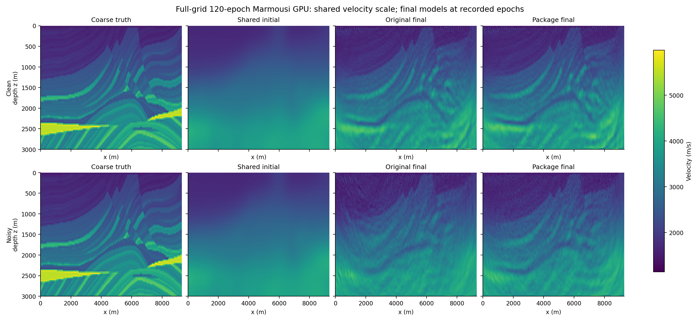

# FWIGAN

A research toolkit for 2D acoustic full-waveform inversion with conventional FWI and adversarial FWIGAN. Both methods share DeepWave physics, configuration, evaluation and checkpoint/resume workflows.

## Installation

Use **Python 3.10** and a C++ compiler. Install PyTorch before building the pinned DeepWave backend:

```bash
python3.10 -m venv .venv
source .venv/bin/activate
python -m pip install setuptools==69.5.1 wheel==0.45.1
python -m pip install torch==1.13.1+cpu --index-url https://download.pytorch.org/whl/cpu
python -m pip install numpy==1.23.5 scipy==1.10.1
MAX_JOBS=2 python -m pip install --no-build-isolation deepwave==0.0.9
python -m pip install -e '.[test,plot,notebook]'
```

These commands install the CPU environment. For GPU setup, see [CUDA instructions](docs/performance.md#cuda-measurement).

## Quick start

Run a small FWIGAN experiment from the repository root:

```bash
fwigan invert --config configs/tiny-fwigan.yaml --output-root runs --max-batches 2
```

The command prints the new run directory. Use that path to continue and inspect the result:

```bash
fwigan resume runs/<run-id>/checkpoint.pt --device cpu
fwigan evaluate runs/<run-id>
```

Use `configs/tiny-fwigan-noisy.yaml` for noisy FWIGAN or `configs/tiny-fwi.yaml` for conventional FWI. All three presets use small CPU examples. Full Marmousi presets are in `configs/marmousi-*.yaml`.

For interactive work, open [FWIGAN.ipynb](notebooks/FWIGAN.ipynb) or [FWIGAN_Noisy.ipynb](notebooks/FWIGAN_Noisy.ipynb) and select the environment's Python kernel.

## FWIGAN simulation results



Full-grid Marmousi FWIGAN simulations completed **120 epochs on an NVIDIA A40**. The package's velocity RMSE fell from **478.00 m/s** to **412.91 m/s** for clean data and **462.52 m/s** for noisy data. These are single-run results, covering 120 of the original study's 401 epochs. See the [comparison report](docs/validation/marmousi-120epoch.md) for executed notebooks, metrics and limitations.

## Documentation

- [Configuration, data contracts and checkpoint workflows](docs/workflow.md)
- [Performance measurements and GPU setup](docs/performance.md)
- [Tests and validation record](docs/validation/validation.md)

Run `python -m pytest -q` to execute the tests.

## Attribution and license

Originally developed by Muhammad Izzatullah, inspired by [physics-informed adversarial geophysical imaging](https://arxiv.org/abs/2109.11452) and [CryoGAN](https://ieeexplore.ieee.org/document/9483649). Released under the [MIT license](LICENSE).
