# FWIGAN · a reproducible acoustic inversion research toolkit

[](https://www.python.org/)
[](https://pytorch.org/)
[](LICENSE)

FWIGAN makes **conventional full waveform inversion (FWI)** and the repository's original **adversarial FWIGAN** experiment usable through a shared 2D acoustic forward model, survey and observation contracts, evaluation metrics, and resumable runs. The two methods answer different optimization questions on the same recorded waveforms. FWI minimizes a raw pressure residual with a known source; FWIGAN trains a critic against normalized shot groups and updates its physical parameters from that critic. This is a research toolkit for controlled comparisons, not evidence that one method is generally superior.

The notebooks are thin package clients with bounded CPU defaults. The original velocity tensors, illustrations, attribution and frozen reference cells are preserved. Small experiments let changes be checked without a full Marmousi inversion.

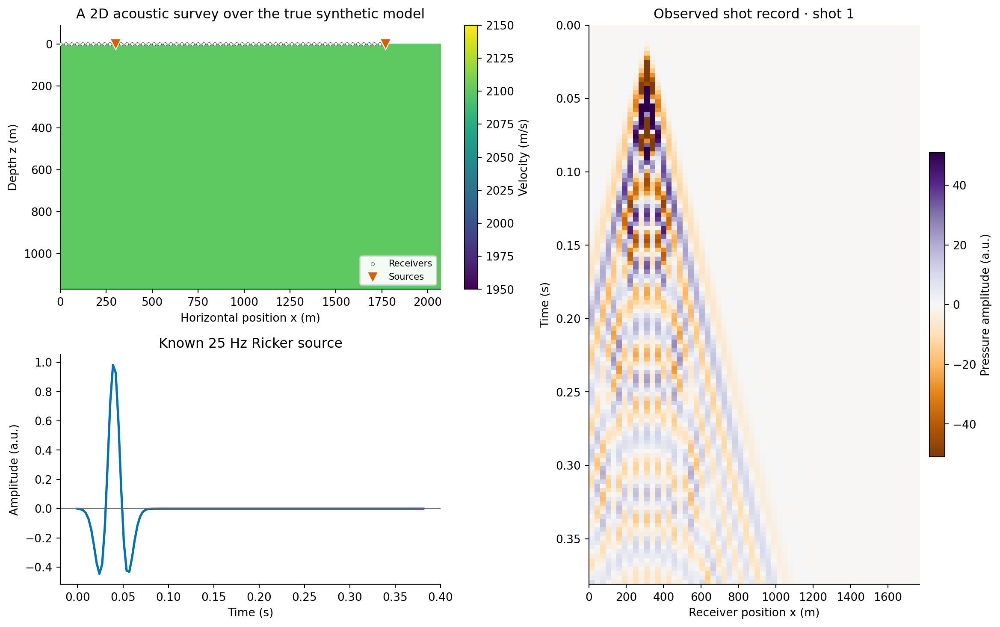

*A real DeepWave 0.0.9 forward solve on a 40 × 70 cell, 30 m grid. Two surface shots use a known 25 Hz Ricker wavelet and 60 receivers. The observed pressure record is synthetic and noise free; amplitude is in arbitrary units. Truth and inversion share a grid in this illustrative example (an inverse crime).*

## What the two methods share

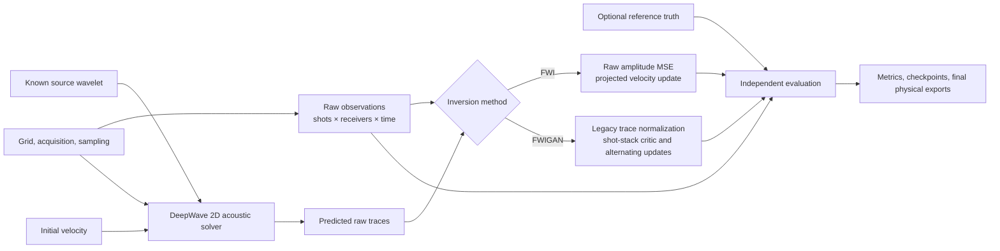

| | Conventional FWI | Legacy FWIGAN |
| --- | --- | --- |
| Training signal | Mean squared raw pressure residual over all shots | Wasserstein-style critic score with gradient penalty on normalized traces |
| Physical variables | Velocity; observed-data source is fixed | Velocity and optionally source and Gaussian noise scale |
| Update schedule | One full-shot, possibly batched gradient accumulation per logical epoch | Critic cycles, then one physical update per shot group |
| Trace treatment | Raw amplitude | Each trace divided by `abs(max(trace)) + 1e-10`, preserving the historical convention |
| Critic input | None | One shot group as `[1, shots_in_group, time, receivers]` |
| Comparable diagnostics | Raw pressure residual MSE; optional velocity RMSE when truth exists | The **same** raw diagnostics; critic loss is not a model accuracy measure |

The shared DeepWave adapter returns unnormalized deterministic traces. The legacy transform is applied only inside adversarial training. FWI and FWIGAN may therefore be compared on the same raw observations even though their training objectives differ.

The code uses a Strategy for each objective/update schedule, an Adapter for the pinned solver, an `Experiment` application service that composes these roles with an injectable forward model, and versioned snapshots for continuation. See [roles, files and rationale](docs/workflow.md#roles-and-practical-patterns). Optional FWI `regularization` weights squared adjacent-cell velocity differences without dividing by spacing, so its weight is grid-dependent.

## Install

Use Python **3.10** and the pinned legacy stack. DeepWave 0.0.9 builds against the installed PyTorch headers, so install Torch first and install DeepWave without build isolation. From the repository root:

```bash
python3.10 -m venv .venv
source .venv/bin/activate
python -m pip install setuptools==69.5.1 wheel==0.45.1
python -m pip install torch==1.13.1+cpu --index-url https://download.pytorch.org/whl/cpu
python -m pip install numpy==1.23.5 scipy==1.10.1
MAX_JOBS=2 python -m pip install --no-build-isolation deepwave==0.0.9
python -m pip install -e '.[test,plot,notebook]'
OMP_NUM_THREADS=2 MKL_NUM_THREADS=2 python -m pytest -q
```

This is the verified CPU installation. The pinned backend also passed four CUDA-specific integration checks on an RTX 4090 using Torch `1.13.1+cu117`; see [CUDA build instructions](docs/performance.md#cuda-measurement) and [validation status](docs/validation/validation.md). PyYAML is a runtime dependency for configuration. The `plot` extra supplies Matplotlib; `notebook` supplies the plotting and Jupyter client dependencies. The old DeepWave extension requires Torch before building, a C++ compiler, and the pinned Setuptools build tools above. Modern backend substitutions require separate numerical validation.

## Run a bounded FWI experiment

This example uses the public Python API currently present in the package. It generates two noise-free shots from a 2100 m/s homogeneous truth and starts inversion from 2000 m/s. The lower bound of **2000 m/s** is an explicit prior, equal to the initial model; set bounds for your own physical problem rather than silently importing this choice.

```python
from fwigan.config import ExperimentConfig
from fwigan.data.synthetic import make_tiny_data
from fwigan.experiment import Experiment

data = make_tiny_data(seed=42, nt=128, shots=2, receivers=60)
config = ExperimentConfig(
    method="fwi", device="cpu", seed=42, epochs=24,
    batch_size=2, velocity_lr=5.0,
    velocity_min=2000.0, velocity_max=2300.0,
    evaluation_interval=1, checkpoint_interval=24,
)
experiment = Experiment.create(config, data, output_root="runs")
initial = experiment.evaluate()
experiment.run()                  # advances to configured total epochs
print(initial["raw_residual_mse"], experiment.evaluations[-1]["raw_residual_mse"])
print(experiment.run_dir)
```

`run(epochs=N)` uses an **absolute total epoch target**, not N additional epochs. `run(max_batches=N)` stops after at most N more steps; an FWI step is one complete logical epoch, while an FWIGAN step is one shot group. Each call saves a checkpoint. Periodic evaluation is a deterministic raw forward solve and is independent of the training objective.

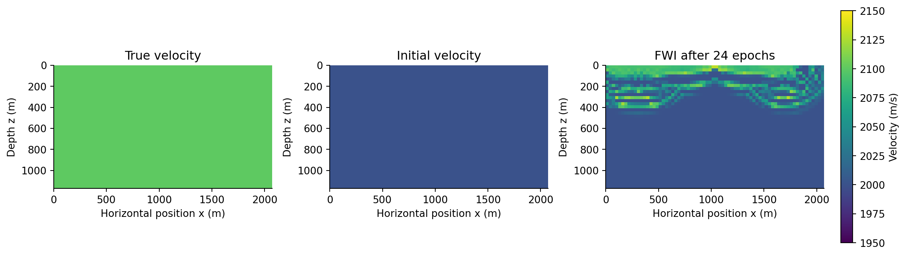

*The same 24 epoch FWI example. All panels use one velocity scale and physical metre axes. The inversion improves model RMSE from 100.0 to 91.19 m/s, but changes concentrate near the illuminated surface; it does not recover the homogeneous truth throughout the domain.*

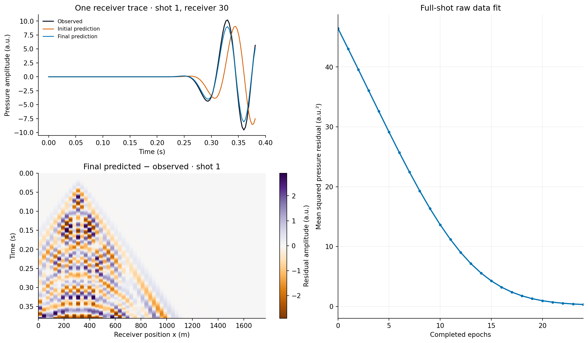

*A receiver trace, final predicted-minus-observed shot residual, and full-shot raw pressure MSE from the same solver run. MSE decreases from 46.47 to 0.320 (arbitrary pressure units squared). This small, noise-free example verifies an executable FWI path and a better data fit under the stated prior. It makes no claim about full Marmousi convergence or FWIGAN superiority. Figure script, exact config, fingerprint, metrics, and numeric arrays are included in [the figure metadata](docs/assets/tiny-fwi-metadata.json); run `python examples/illustrate.py` to regenerate the real solver results and all figures.*

## Bring your own observations

The core contract is `ObservationData` in `fwigan.domain`. All tensors are finite `float32`. Velocity is `[nz, nx]` in **m/s**. Grid spacing and `[z, x]` origin are in **metres**; sampling interval is in **seconds**. Source and receiver coordinates are `[shots, points, 2]` ordered `[z, x]` in physical metres and must lie on grid cells. The source wavelet is `[shots_or_1, sources, time]`; the canonical raw observation array is `[shots, receivers, time]`.

```python
from fwigan.domain import GridSpec, SamplingSpec, Acquisition, ObservationData
from fwigan.data.io import load_observations, save_observations

# Build the tensors and metadata with the shapes and units above.
dataset = ObservationData(
    traces=recordings, acquisition=Acquisition(source_coordinates, receiver_coordinates),
    grid=GridSpec(shape=initial_velocity.shape, spacing=30.0),
    sampling=SamplingSpec(nt=recordings.shape[-1], dt=0.003),
    source=known_source, initial_velocity=initial_velocity,
    reference_velocity=None,
)
save_observations("recordings.pt", dataset)
dataset = load_observations("recordings.pt")
```

The variables in this snippet stand for your measured or generated tensors; load them from your own source before constructing `ObservationData`. A truth model is optional. Source amplitudes are grid-specific coefficients for the pinned backend in arbitrary units. FWI requires `source` to be the known, fixed coefficient wavelet on the inversion grid associated with the recordings; imported observations are not automatically recalibrated. For FWIGAN, `initial_source` may additionally provide a separate trainable source initializer; if absent, the observed-data `source` initializes it. The loaded artifact includes a content fingerprint and is intended for trusted local `torch.save` files.

## Run FWIGAN with the legacy critic

The adversarial method deliberately retains the notebook's trace normalization and shot-stack critic. It requires at least 32 time samples and **32–63 receivers**, and the number of shots must divide evenly into `batches`. For example, the tiny dataset above has two shots, 60 receivers, 128 samples, and can use two one-shot groups:

```python
gan_config = ExperimentConfig(
    method="fwigan", device="cpu", seed=42, epochs=2,
    batches=2, batch_size=1, critic_cycles=6,
    noise=False, train_source=True,
)
gan = Experiment.create(gan_config, data, output_root="runs")
gan.run(max_batches=2)
print(gan.run_dir, gan.position)
```

The critic scores a **whole shot group**, not independent shots. Training source amplitude is poorly identifiable after independent trace normalization. The optional Gaussian noise scale is in normalized-data units and should not be read as the physical recording noise level. These are properties of the preserved legacy method, and they matter when interpreting recovered parameters.

During each adversarial step, the solver is called once and differentiated once for the physical update. Critic updates consume a detached version of that same prediction; critic weights are frozen during the physical backward pass while the input gradient remains available. At six critic cycles, this removes six solver adjoints per step compared with the original notebook loop (seven to one). It is a **solver work count**, not a claim of sevenfold runtime improvement.

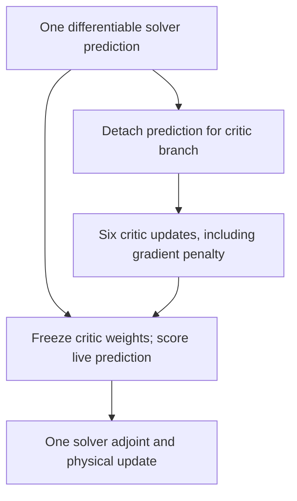

## Resume, warm start, and inspect artifacts

`resume` continues the **same** run and restores the physical state, critic if present, optimizers, schedulers, random streams, data identity, and next epoch/batch position. Keep the run directory's `run.json`, `config.json`, and `observations.pt` with its checkpoint. Load only trusted checkpoints. Restored RNG and state do not guarantee a bit-exact GPU training trajectory; see the [numerical limits](docs/validation/validation.md#gpu-numerical-limits).

```python
continued = Experiment.resume("runs/<run-id>/checkpoint.pt", device="cpu")
continued.run(epochs=continued.config.epochs)
print(continued.evaluate())
continued.export_final()
```

`warm_start(checkpoint, config, data, output_root)` starts a **new** run from the saved physical velocity (and FWIGAN source/sigma where applicable), with a new optimizer, critic, history, and random stream. Its grid and sampling must match the source run. This is the appropriate path when changing configuration or observations; resume validates the original run's immutable files and fingerprints.

Each run directory contains:

| Artifact | Contents |
| --- | --- |
| `config.json`, `run.json` | Resolved numerical settings, run ID, data/config fingerprints, Python and library versions, device |
| `observations.pt` | Canonical raw traces, acquisition, source, initial model, optional reference truth |
| `checkpoint.pt` | Complete continuation snapshot, updated atomically |
| `final.pt` | Physical velocity/source/sigma, final raw prediction, independent metrics and solver counts; written on completion or by `export_final()` |

The result's velocity tensor is in physical m/s. `raw_residual_mse` is available whether or not truth exists; `model_rmse` is included only when a reference model is supplied. The example illustration's numerical arrays and metadata live in [the numeric archive](docs/assets/tiny-fwi-results.npz) and [metadata](docs/assets/tiny-fwi-metadata.json).

## Command line and notebook workflows

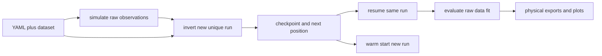

Run from the repository root after installing the package. These commands use bounded CPU defaults; `invert` returns its new run directory as JSON. `simulate` refuses to replace existing observations.

```bash
fwigan --help
fwigan simulate --config configs/tiny-fwi.yaml --output runs/tiny-observations.pt
fwigan invert --config configs/tiny-fwi.yaml --output-root runs --max-batches 2
fwigan invert --config configs/tiny-fwigan.yaml --output-root runs --max-batches 2
fwigan invert --config configs/tiny-fwigan-noisy.yaml --output-root runs --max-batches 2
fwigan resume runs/<run-id>/checkpoint.pt --device cpu
fwigan evaluate runs/<run-id>
```

`python -m fwigan` supports the same commands. `--device cpu|cuda|auto` explicitly overrides a preset; CUDA fails clearly if unavailable and never provisions a machine. `--max-batches` also works on `resume`. The tiny FWI preset has the same 24 epoch settings as the illustrations; the bounded command above interrupts after two epochs.

YAML contains two sections, `experiment` and `dataset`. Experiment fields map directly to `ExperimentConfig`; unknown and duplicate keys are errors. Dataset choices are `tiny` (`nt`, `shots`, `receivers`, optional `seed` and raw `noise`), `observations` (`path`), or `marmousi` (`truth_path`, `initial_path`, optional `nt`). Every dataset path is relative to its YAML file. To invert the simulated artifact, copy a tiny preset and replace its dataset section:

```yaml
dataset:
  kind: observations
  path: ../runs/tiny-observations.pt
```

Tiny `dataset.noise` is additive raw pressure noise; FWIGAN `experiment.observation_noise_level` is additive noise **after legacy normalization**. They have different units. `sigma_init` initializes learned fake noise in normalized units, and the preserved legacy sigma can become signed. FWI keeps the known `data.source` fixed and disables trainable source/sigma.

Use [FWIGAN.ipynb](notebooks/FWIGAN.ipynb) or [FWIGAN_Noisy.ipynb](notebooks/FWIGAN_Noisy.ipynb) with this environment's Python kernel. They load the same YAML and data as the CLI, call `Experiment.create/run/resume/evaluate/export_final`, and plot physical models and raw traces. There are no installation shell cells or private paths. Edit `CONFIG` to opt into another preset.

The `configs/marmousi-*.yaml` presets are expensive opt-in experiments: fine 3 m truth, coarse 30 m inversion grid, 30 shots, 60 receivers, 2000 samples at 0.003 s, observed 7 Hz source, 10 Hz FWIGAN initial source, sigma 10 Gaussian initial-model smoothing, and 401 epochs. Raw simulation occurs on the fine grid; the coarse reference samples matching physical points. The fine simulation keeps its original unscaled 7 Hz coefficients. The stored known inverse-grid source is multiplied by the exact cell-area factor `(3/30)^2 = 0.01` for both methods, because DeepWave 0.0.9 injects into one cell without area normalization. FWI fixes this calibrated 7 Hz coefficient; FWIGAN retains its original unscaled 10 Hz initializer. The tiny same-grid factor is one. [A real bounded interior calibration check](docs/validation/grid-source-calibration.md) confirms the amplitude correction; surface, colocated-source, PML and dispersion differences still prevent a claim of full raw Marmousi equivalence. The package does not claim full Marmousi convergence or performance. See [workflow details](docs/workflow.md) and [performance evidence and limits](docs/performance.md).

## Performance and reproducible illustrations

The benchmark compares the frozen original notebook loop with actual `FWIGANStrategy`, using identical warmed physical/critic/Adam/scheduler/scaler/RNG state and checking successful update counts. It records numerical errors and actual DeepWave forward/adjoint calls. Timing has no CI threshold.

```bash
OMP_NUM_THREADS=2 MKL_NUM_THREADS=2 python examples/benchmark.py --device cpu --suite tiny --output runs/benchmark-cpu.json
OMP_NUM_THREADS=2 MKL_NUM_THREADS=2 python examples/illustrate.py
```

CPU timing applies only to this tiny workload. CUDA must be measured separately; `--suite all --device cuda` adds a representative synthetic constant-model workload (100×310 grid, 2000 samples, five shots, six critic cycles). This tests capacity and equivalent work, not Marmousi recovery. [Performance documentation](docs/performance.md) explains synchronization, memory, AMP startup skips, and backend limits.

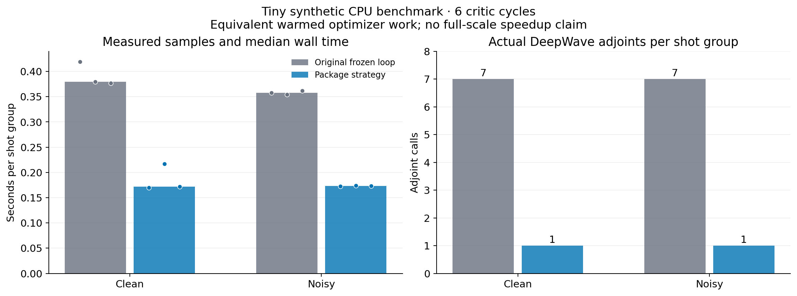

*Actual clean/noisy nt128, two-shot, six-cycle CPU samples: original medians 0.3793/0.3573 seconds per group, package 0.1715/0.1735. Physical/Adam/gradient updates and RNG agree exactly; native adjoints decrease seven to one. This shared-host tiny result does not establish GPU or full Marmousi performance. [Raw JSON and measurement details](docs/performance.md#recorded-tiny-cpu-result).*

## Verify and extend

Run `python -m pytest -q` for contracts, strategy behavior, gradient checks, and lifecycle tests. The bounded DeepWave FWI example above is an additional numerical smoke check.

| Recorded check | Result |
| --- | --- |
| Hosted CPU suite at `f54f251` | Push and PR checks each passed 215 tests; four optional CUDA tests skipped on CPU |
| CLI and notebooks | Simulation, both methods, interruption/resume and evaluation exercised; both notebooks executed |
| RTX 4090 GPU suite at `7339f63` | 215 passed, zero failed or skipped, including all four CUDA-specific checks |
| Equivalent-work GPU benchmark | Tiny-clean failed numerical parity after two epochs across physical, critic, optimizer and gradient state; no CUDA timing or memory result is accepted |

Exact commits, tolerances, failed comparison paths, and verified deletion of the test Pods are in [the validation record](docs/validation/validation.md). The opt-in repeatability diagnostic has passed CPU checks but has not run on CUDA; a subsequent GPU provisioning attempt failed before creating a Pod. CUDA checks do not establish measured GPU speedup, full Marmousi recovery, or superiority of the adversarial objective. No GPU benchmark figure is included until a complete numerically accepted all-workload run exists.

The next scientific steps are low-to-high frequency continuation, constrained source/noise studies, a separately validated per-shot critic, and a separately calibrated modern DeepWave backend. Keep method, data, acquisition, and independent evaluation fixed when comparing new methods.

## Attribution and license

This repository originated as Muhammad Izzatullah's FWIGAN PyTorch/DeepWave implementation, motivated by [*Revisit Geophysical Imaging in A New View of Physics-informed Generative Adversarial Learning*](https://arxiv.org/abs/2109.11452) and [*CryoGAN: A New Reconstruction Paradigm for Single-Particle Cryo-EM Via Deep Adversarial Learning*](https://ieeexplore.ieee.org/document/9483649). The original notebooks and illustrations are preserved in the repository. See [LICENSE](LICENSE) for the 2021 Muhammad Izzatullah MIT license. The new documentation figures are generated from a real, bounded DeepWave example by `examples/illustrate.py` and carry the same project license.

### Original project illustrations

These historical images are retained as original project material; they are separate from the bounded example above.

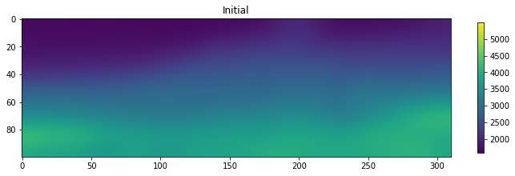
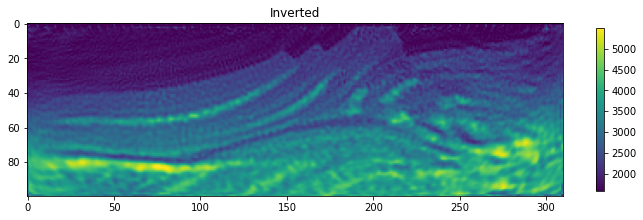
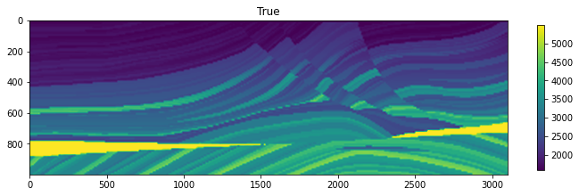
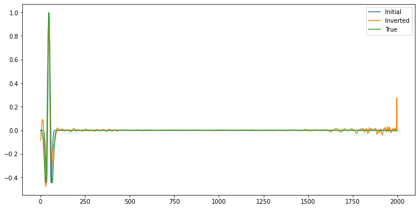
