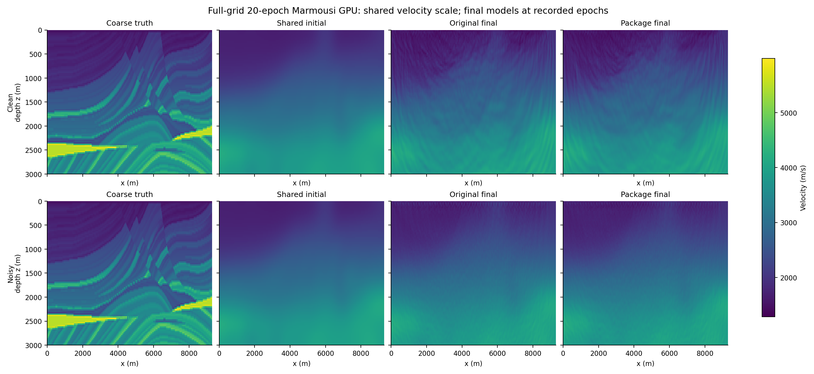
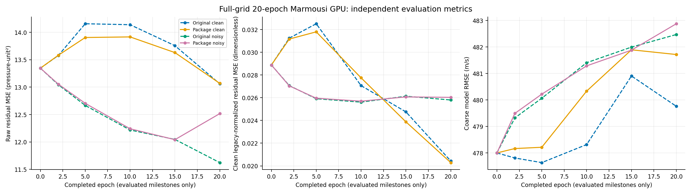

# Full-grid Marmousi notebook comparison: 20 epochs

Five real notebooks completed 20 epochs on one NVIDIA A40: the original clean and noisy FWIGAN notebooks, their package counterparts, and a package-only conventional FWI companion. The four adversarial runs used the same fine-grid generated observations and matched initial physical parameters, critic, normalized target, and Python/NumPy/Torch/CUDA RNG states. This is a selected, short horizon on the full geometry, **not** the notebooks' 401-epoch study or evidence of convergence. The original and package final velocity fields differ substantially; the comparison establishes a common starting point and executable workflows, not numerical field parity.



The [SVG velocity models](../assets/marmousi-20epoch-velocity-models.svg) show sampled coarse truth, the shared initializer, and the four recovered models on one m/s scale. The [difference maps](../assets/marmousi-20epoch-velocity-differences.png) ([SVG](../assets/marmousi-20epoch-velocity-differences.svg)) use a common symmetric scale for package minus original. Their full-grid differences have RMSE **75.53593 m/s** and maximum absolute difference **379.552 m/s** for clean data, and **24.48325 m/s** and **102.8635 m/s** for noisy data. The coarse-grid model RMSE against sampled truth starts at **478.003 m/s** and is worse after 20 FWIGAN epochs in every case: original/package clean **479.761/481.715 m/s**; original/package noisy **482.470/482.876 m/s**. Reduced data mismatch at this horizon therefore does not establish better velocity recovery.

## Shared experiment and measurements

The true Marmousi model has **1000 × 3100** cells at **3 m** spacing; the inversion uses **100 × 310** cells at **30 m**. Acquisition uses **30 shots**, **60 receivers per shot**, **2000 samples** at **0.003 s**, six five-shot groups, and six critic cycles. Fine-grid 7 Hz observations were generated once, using all shots, then reused as raw `[shot, receiver, sample]` traces. The generator used an unscaled 10 Hz source initializer. The known coarse-grid 7 Hz source coefficient is **0.01 ×** the unscaled fine-grid 7 Hz waveform, as required by the pinned cell-source discretization. The environment was PyTorch **1.13.1+cu117**, DeepWave **0.0.9**, CUDA build **11.7**, and an NVIDIA A40. The original notebooks came from `c7ec47ed89ba1380ad7a02bbc4526b93675e76f3`; the package source was `2b179f954b0ab5c7fb617cbab4c671dd6afa1f50`.

| Case at epoch 20 | Raw residual MSE (pressure unit²) | Clean normalized MSE | Model RMSE (m/s) | Source cosine | Source norm / unscaled 7 Hz | Signed σ | Physical updates / skips | Critic updates / skips |
| --- | ---: | ---: | ---: | ---: | ---: | ---: | --- | --- |
| Original clean | 13.0605 | 0.020432 | 479.761 | 0.8458 | 0.8469 | 1.0 | 117 / 3 | 711 / 9 |
| Package clean | 13.0684 | 0.020287 | 481.715 | 0.8470 | 0.8428 | 1.0 | 117 / 3 | 711 / 9 |
| Original noisy | 11.6228 | 0.025797 | 482.470 | 0.8680 | 0.8425 | +0.04280 | 117 / 3 | 706 / 14 |
| Package noisy | 12.5167 | 0.026027 | 482.876 | 0.8677 | 0.8431 | +0.04691 | 117 / 3 | 707 / 13 |

Raw residual MSE compares raw predicted and shared observed traces. “Clean normalized MSE” compares legacy-normalized predictions with the **clean** normalized shared observations even for noisy runs; it does not include the noise added once to the adversarial target. Legacy normalization divides each trace by `abs(max(time)) + 1e-10`, rather than the maximum absolute sample. Source cosine measures waveform shape. Learned source norms are about **84× the calibrated coarse 7 Hz coefficient**, because that coefficient is 0.01× the unscaled reference; source amplitude is weakly identified under per-trace normalization. Signed σ is in normalized-data units. The configured noisy target has standard deviation **0.05**, which is a setup value, not a guaranteed recoverable σ.



The [metric-history SVG](../assets/marmousi-20epoch-metric-histories.svg) connects measured milestones only. The [source and sigma figure](../assets/marmousi-20epoch-source-and-sigma.png) ([SVG](../assets/marmousi-20epoch-source-and-sigma.svg)) labels the unscaled fine-grid and calibrated 0.01× coarse-grid source amplitudes separately. Its waveform preview shows the first 0.6 s; norm ratios use the full 6 s waveform.

The package-only FWI companion used the fixed calibrated coarse-grid source and the same raw observations. At epoch 20 its raw residual MSE was **0.00215758 pressure unit²**, **12.6246%** below its own initial value; model RMSE was **477.906 m/s**. There is no original-notebook FWI comparator here, and this result cannot rank FWI against FWIGAN convergence.

## Work, time, and limits

| GAN run | Synchronized training-only time (s) | Whole executed-notebook wall time (s) |
| --- | ---: | ---: |
| Original clean | 91.488 | 100.182 |
| Package clean | 49.116 | 106.403 |
| Original noisy | 83.305 | 91.887 |
| Package noisy | 49.079 | 105.734 |

The original/package training-time ratio was **1.86×** for clean and **1.70×** for noisy in these single observed pairs. Training-only timing excludes evaluation and checkpoint I/O. The package's **whole notebook took longer** in both pairs: this driver deliberately exercised an epoch-2 resume, called `run()` through epoch 20, and wrote a mandatory checkpoint each epoch. These differences in measured workflow overhead prevent an overall speedup claim. They do not overturn the separate equivalent-work CUDA benchmark's unresolved 44-field material comparison failure. [Work and resource figure](../assets/marmousi-20epoch-work-and-resources.png) ([SVG](../assets/marmousi-20epoch-work-and-resources.svg)) reports actual/skipped optimizer calls and process-live cumulative CUDA allocated/reserved peaks; these are not per-epoch memory increments.

The source and observations are controlled, but CUDA native reductions and adversarial AMP/critic paths need not follow identical floating-point trajectories. The original notebook numerical cells 8, 10, and 12 retained their frozen hashes. The executed copies substitute shared-observation input, bounded loop length, output paths, and measurement/export hooks; the original generator's optimizer-only checkpoint does not contain its unregistered physical tensors, so separate physical exports do not imply original-notebook resumability. The package notebook's checkpoint/resume ran on the GPU and its run identity and data fingerprint were checked. **The full resumable checkpoint was not returned:** its compressed size was **677,893,572 bytes**, above the conservative **400 MiB** artifact allowance. The selected bundle includes final physical exports and executed notebooks, but readers cannot resume this exact run from the public evidence.

## Evidence and reproduction

The [result](marmousi-20epoch/result.json), [artifact manifest](marmousi-20epoch/artifact_manifest.json), [figure provenance](marmousi-20epoch/figure-provenance.json), and [filtered controller summary](marmousi-20epoch/control-summary.json) identify source hashes and verified inputs. The retained, hash-verified local bundle archive is **71,305,720 bytes**, SHA-256 `ae28d4f4900f4bc89ee981e75eb8ae6ae80da1729bd0e060978f60312e87e24f`; large physical tensors, shared traces, checkpoints, and the archive are excluded from Git. The shared-observation tensor SHA-256 is `20b9d72e97b0ab2e08b02d10534f6665aa9b407bdb011039e9d9c0715ba65db1`, and the raw trace SHA-256 is `7d3f351e4c14e2e302257988122b9d3bb131f7f3d948ac2b9a96808e4acd21f2`.

The public small artifacts include all five [executed notebooks](marmousi-20epoch/FWIGAN-old-executed.ipynb) (also [package clean](marmousi-20epoch/FWIGAN-new-executed.ipynb), [original noisy](marmousi-20epoch/FWIGAN_Noisy-old-executed.ipynb), [package noisy](marmousi-20epoch/FWIGAN_Noisy-new-executed.ipynb), [FWI](marmousi-20epoch/FWI-new-executed.ipynb)) and per-epoch metrics ([original clean](marmousi-20epoch/FWIGAN-old-metrics.json), [package clean](marmousi-20epoch/FWIGAN-new-metrics.json), [original noisy](marmousi-20epoch/FWIGAN_Noisy-old-metrics.json), [package noisy](marmousi-20epoch/FWIGAN_Noisy-new-metrics.json), [FWI](marmousi-20epoch/FWI-new-metrics.json)). Original numeric-cell SHA-256 values are recorded in `result.json`; both original notebooks have matching hashes for cells 8/10/12. Every executed code cell finished without an error, and all five metric files contain the requested epoch-20 result.

The frozen [workflow driver](marmousi-20epoch/notebook_workflow_comparison.py) SHA-256 is `0300465cd02bae8d351be8f59ee8e00566df32ec5aab643ea7d611c0d6748b3e`; the [figure renderer](marmousi-20epoch/render_workflow_comparison.py) is `98c9b3654fa4ce2b6450d71a64a05b57fd0aa852c38f3887c3e09971f68542cb`. The [bounded GPU controller snapshot](marmousi-20epoch/run_workflow_comparison.py) is `8031085d2440f8e22003f5e53a2392f3ab7326f6e73076ed44519a6986961c28`. That controller imports outside-only orchestration helpers which are not published here; the snapshot is for audit, **not a standalone launch command**. To rerun the notebooks, first set up pinned Python 3.10 / Torch 1.13.1+cu117 / DeepWave 0.0.9 as described in [CUDA measurement](../performance.md#cuda-measurement), then install the notebook execution dependencies and obtain the untouched originals:

```bash
python -m pip install nbformat==5.10.4 nbclient==0.10.2 ipykernel==6.31.0
mkdir -p /tmp/fwigan-original-c7
git archive c7ec47ed89ba1380ad7a02bbc4526b93675e76f3 notebooks | tar -x -C /tmp/fwigan-original-c7
workflow_deadline=$(python -c 'import time; print(time.time()+14400)')
python docs/validation/marmousi-20epoch/notebook_workflow_comparison.py \
  --repo . --original-root /tmp/fwigan-original-c7 \
  --output-dir /tmp/fwigan-marmousi-20epoch --epochs 20 --device cuda \
  --deadline-utc "$workflow_deadline" \
  --status-file /tmp/fwigan-marmousi-20epoch-status.json
python docs/validation/marmousi-20epoch/render_workflow_comparison.py \
  --bundle /tmp/fwigan-marmousi-20epoch \
  --output-dir /tmp/fwigan-marmousi-20epoch-figures --repo .
```

The owned A40 Pod (`xjbhtwvkopr16m`) was deleted; its individual GET returned 404 and a fresh account list contained no owned Pods, as recorded in an [independent cleanup check](marmousi-20epoch/independent-pod-cleanup.json). At the recorded **$0.59/hour** and **880.162539 s** lifetime, its compute estimate is **$0.144249**, not an invoice. The retrieval manifest verified the 71 MB archive. This run stayed within the authorized $10 cap; the [budget ledger](marmousi-20epoch/budget-ledger.json) records the prior package compute estimate as $0.537236 and the guarded combined estimate as about $0.698355 before the $0.50 contingency. The guard adds a 10% rate uplift and $0.01/hour storage allowance; it is an estimate, not measured transport cost or an invoice. No more GPU runs were launched for this comparison.
