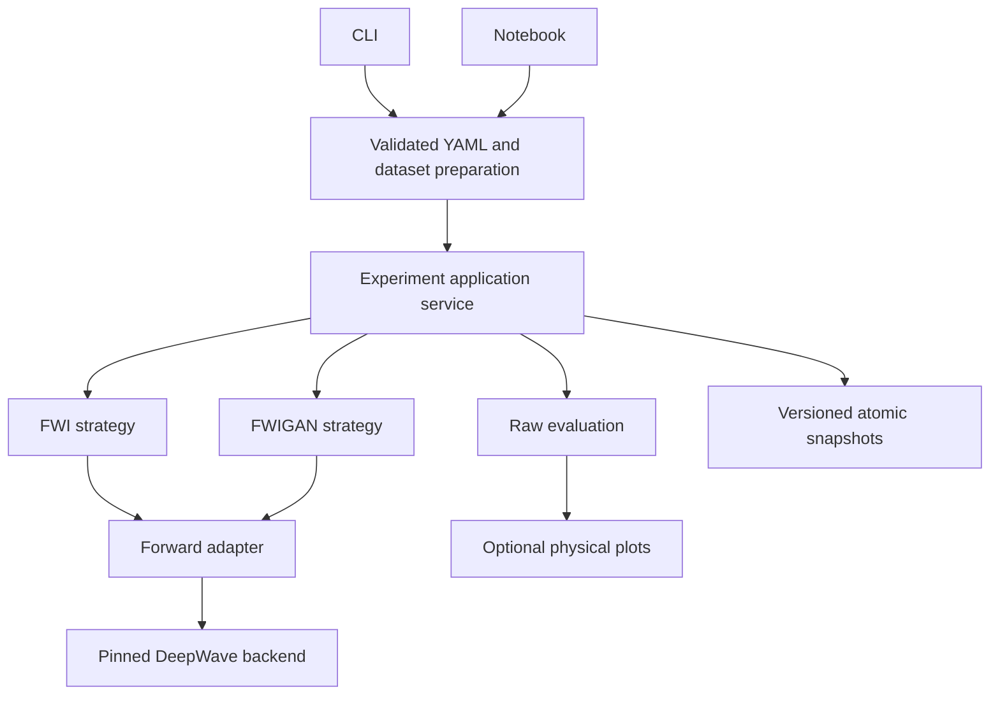

# Workflow and architecture

Use the repository's Python 3.10 environment and install Torch before building DeepWave 0.0.9. The README gives the exact CPU ordering and pinned build tools. All examples default to tiny CPU work; neither the package nor its CLI provisions a GPU.

## Roles and practical patterns

| Role and file | Pattern | Why it exists |
| --- | --- | --- |
| `domain.py`, `config.py` | Explicit value contracts | Keep physical units, canonical shapes and numerical settings validated across clients. |
| `physics/deepwave.py` | Adapter | Translate canonical `[shot,receiver,time]` tensors and physical geometry to the pinned legacy solver without altering its science. A forward implementation can be injected into an experiment. |
| `inversion/fwi.py`, `inversion/adversarial.py` | Strategy | Each method owns its objective, optimizer groups and update schedule; conventional least squares does not inherit adversarial assumptions. |
| `experiment.py` | Application service using composition | Coordinate data, strategy, evaluation and artifacts. `Experiment.create(..., forward=...)` makes the forward dependency explicit without an unused registry. |
| `checkpoints.py` and experiment snapshots | Versioned snapshot | Preserve the complete restart state and reject incompatible or corrupted artifacts; publish writes atomically. |
| `cli.py`, notebooks, `plotting.py` | Thin clients | Share YAML preparation and the public lifecycle while leaving solver and trainer code in the package. |



## Configuration and physical contracts

A YAML workflow has exactly `experiment` and `dataset` sections. `load_config(path, device=None)` rejects unknown/duplicate fields and resolves input paths relative to that file, before training. `prepare_data(workflow)` returns `ObservationData`; both CLI and notebooks pass it to `Experiment.create`. Numerical configuration is immutable after creation.

Canonical velocity `[nz,nx]` is float32 in m/s. Acquisition coordinates `[shots,points,2]` are physical metres ordered `[z,x]` and must lie on grid cells. Sampling is in seconds. Source `[shots_or_1,sources,time]` broadcasts only its explicit one-shot axis. Raw recordings and predictions are `[shots,receivers,time]`. A reference truth is optional, including for external observation inversion. Source amplitudes are backend coefficients in arbitrary units, specific to this grid; imported observations are never automatically source-calibrated.

FWI requires a known fixed source and uses full-data residual sums normalized by the total number of observations, accumulating incomplete batches before one Adam update. Velocity is projected into `velocity_min/max` after each update. Optional `regularization` weights mean squared adjacent-cell velocity differences along each axis; those differences are not divided by spacing, so the weight depends on grid resolution.

FWIGAN preserves the legacy transform `trace / (abs(max_over_time(trace)) + 1e-10)`; it is not absolute-maximum normalization. The critic receives `[1,shot_group,time,receivers]`, requires at least 32 time samples and 32–63 receivers, and requires equal strided shot groups. `batches` controls these groups; FWI's `batch_size` does not change them. Clean/noisy presets preserve Adam betas .5/.9, source/velocity/sigma learning rates .001/5/.01, critic LR .001, StepLR 150/100 with gamma .5, gradient penalty 10, drift .001, and clipping 1000/1e6. The sigma group exists only when enabled.

Observation noise for FWIGAN is added once to normalized observations, seeded before critic initialization and saved in checkpoints. Learned fake noise and sigma use those same normalized units. The legacy learned sigma may become signed. Tiny dataset `noise` instead adds raw-pressure noise and is a separate option. Conventional FWI disables source/sigma fitting and noisy adversarial processing.

## AMP and update isolation

Each FWIGAN shot group makes one differentiable wave solve. Critic cycles consume detached predictions and release their outer graphs. Physical training freezes critic weights while preserving the input gradient, then performs one wave adjoint. CPU AMP is disabled and the wave solver always stays float32. CUDA AMP applies to the critic and uses two independent default GradScalers.

The default scaler may overflow and skip initial optimizer updates while backing off. Actual successful optimizer steps and skipped attempts are tracked separately. Schedulers never advance an optimizer that has not stepped. A short run with skipped updates does not establish useful training or comparable performance; CUDA tests and the benchmark warm until actual updates occur.

## Artifacts, interruption and warm start

`fwigan invert` writes a new unique run directory. `run(epochs=N)` targets an absolute total epoch count. `run(max_batches=N)` bounds additional GAN groups, or whole FWI epochs; it never interrupts a partial FWI accumulation. Each call saves `checkpoint.pt`; completion also writes `final.pt`. Evaluation uses deterministic raw-amplitude predictions independent of noise and preserves random streams.

Resume restores the same run: module state for velocity/source/sigma (including frozen values), critic, every named Adam group and LR, schedulers, portable scaler history, next epoch/batch, metrics, observations, resolved numerical config and identity, Python/NumPy/Torch/CUDA RNG. Keep `run.json`, `config.json`, `observations.pt` with the checkpoint. All saved tensors are CPU-portable; `--device cpu` can inspect a CUDA-origin checkpoint without CUDA. Only load trusted Torch artifacts, since this pinned release deserializes pickle.

```python
from fwigan.cli import load_config, prepare_data
from fwigan.experiment import Experiment

workflow = load_config('configs/tiny-fwigan.yaml')
data = prepare_data(workflow)
new_run = Experiment.warm_start('runs/<old-run>/checkpoint.pt',
    workflow.experiment, data, output_root='runs')
new_run.run(max_batches=2)
```

Warm start creates a new run with fresh critic/optimizer/history/RNG from selected physical state. Grid and sampling must match; FWI retains the new dataset's known source. Change observations or numerical settings this way rather than editing an existing run.

## Marmousi and scientific limits

Full presets explicitly select bundled fine `[1000,3100]` truth at 3 m and coarse `[100,310]` inversion at 30 m, with original surface positions (sources every 300 m, receivers every 150 m), 30 shots and 60 receivers. Raw observations use a 7 Hz Ricker source with peak at 1/7 s on the fine grid. FWIGAN starts from a 10 Hz wavelet with the same peak time and a sigma-10 Gaussian-smoothed coarse velocity. Fine observations retain the exact unscaled original 7 Hz source. The returned `ObservationData.source` contains the known inverse-grid coefficient wavelet `0.01 × Ricker(7 Hz, peak 1/7 s)` for both methods. DeepWave 0.0.9 injects each source coefficient into one cell as `coefficient × vp² × inner_dt²`, with no cell-area division, so matching integrated point forcing requires this deterministic area factor. No empirical trace gain is fitted. FWI fixes the calibrated source; FWIGAN initializes its trainable source from the original unscaled 10 Hz `initial_source`, preserving the legacy path. Coarse truth for evaluation is sampled at matching physical points with `[::10,::10]`.

The illustrated tiny FWI case uses the same grid for truth and inversion (an inverse crime), a homogeneous model, no recording noise, and an explicit 2000 m/s lower bound. It demonstrates execution and a better data fit, not general recovery. The [full-grid Marmousi comparison](validation/marmousi-120epoch.md) completed 120 epochs for original/package clean and noisy FWIGAN and a conventional FWI companion; the full 401-epoch study remains unrun. Source amplitude is weakly identifiable after independent trace normalization; critic loss alone is not a model metric.

The [bounded real CPU source-calibration check](validation/grid-source-calibration.md) uses an interior homogeneous model, off-source receivers, equal physical PML widths and aligned positions. The theoretical 0.01 gain reduces relative raw L2 error from about 99.3 to 0.0262. It does not establish complete Marmousi raw agreement: product surface/colocated positions, fixed PML cell counts on different grids and spatial/temporal dispersion retain additional grid dependence. Tiny same-grid examples need no correction (factor one), and external artifacts must supply their own correct inversion-grid coefficient wavelets.
